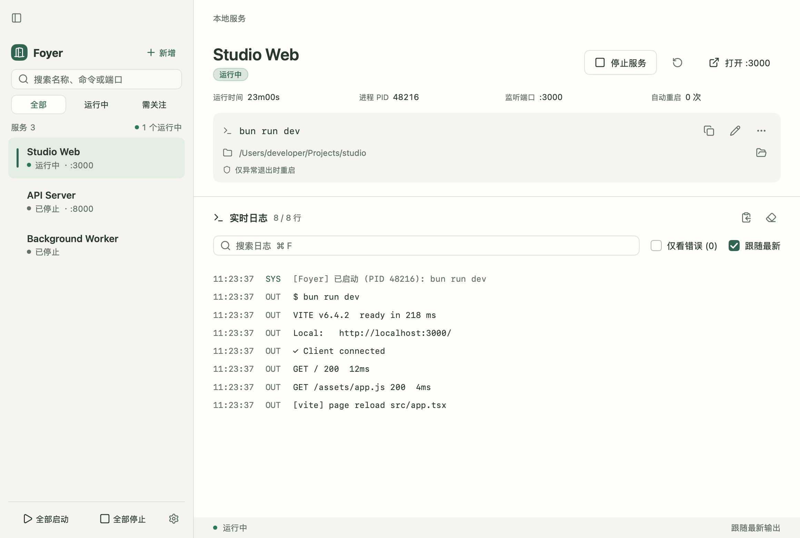

# Foyer

**简体中文** · [English](README.md)

把常用的本地服务，收进一个窗口。

如果你每次开工都要打开几个终端窗口、找到项目目录、输入同样的命令，Foyer 可以帮你把这些步骤保存下来。下次只需点一下，就能启动网页项目、聊天工具或后台任务，随时查看状态和输出。

**[下载最新版](https://github.com/pinweb/foyer-releases/releases/latest)** · [反馈问题](https://github.com/pinweb/foyer-releases/issues)

## 它能帮你做什么

- **把服务放在一起。** 保存项目目录和启动命令，一键启动、停止或重启，也可以批量操作。
- **随时知道运行情况。** 查看服务状态、运行时间和日志，遇到异常时更容易找到原因。
- **少操心意外退出。** 按需开启自动重启，服务异常退出后由 Foyer 尝试重新启动。
- **让窗口少一点。** 关闭窗口后仍可在菜单栏管理服务，也可以隐藏 Dock 图标。
- **留好配置副本。** 修改服务前自动备份，需要时可以导出或恢复。

## 免费版与激活

Foyer free 可管理 3 个服务。以 $6 一次买断激活 Foyer 后，可管理无限服务，并在应用打开时自动启动服务。登录启动应用、日志、异常自动重启和备份功能继续免费提供。

在「设置 → 激活」中购买并输入邮件中的激活码。每份激活码支持最多 3 台 Mac，换机前可在旧设备取消激活。验证成功后支持离线使用 30 天；超额配置始终保留，不会因授权变化而删除。

## 下载与安装

Foyer 目前提供 macOS 版本，请按你的 Mac 芯片选择安装包：

- **Apple Silicon（M 系列芯片）**：下载文件名包含 `arm64` 的 `.dmg`。
- **Intel 芯片**：下载文件名包含 `amd64` 的 `.dmg`。

不确定自己的机型？点击屏幕左上角的苹果菜单，打开「关于本机」即可查看。

打开 [下载页面](https://github.com/pinweb/foyer-releases/releases/latest)，下载对应的 DMG，打开后将 **Foyer** 拖入「应用程序」文件夹，再从那里启动。

安装包已完成开发者签名与 Apple 公证，拖入「应用程序」后即可直接打开。

## 添加你的第一个服务

1. 点击侧栏右上角的「＋」新增服务。
2. 选择项目所在的文件夹。
3. 填入你平时使用的启动命令，例如 `npm run dev` 或 `python app.py`。名称可以自己填写，也可以留空让 Foyer 自动命名。
4. 点击「保存服务」，再点击「启动服务」。

启动后，输出会出现在「实时日志」中。如果服务有网页入口，可以点击右上角的打开按钮进入。

Foyer 不需要你安装 Go 或自行编译。不过，项目本身需要的工具和依赖，例如 Python、Node.js，仍需提前安装好。

## 日常使用

在左侧选择服务，就能查看详情并进行启停操作。服务较多时，可以搜索名称或按「运行中」「需关注」筛选。

日志支持关键词搜索和「仅看错误」。点击一行可以复制内容；关闭「跟随最新」后，可以停下来阅读之前的输出。

遇到端口占用时，Foyer 会显示占用信息。确认对应程序可以关闭后，再使用释放端口并启动的操作。

## 按你的习惯设置

点击侧栏底部的齿轮图标、菜单栏中的「设置…」，或按 `⌘ ,` 打开设置。你可以：

- 在中文与 English 之间切换，自动保存并立即生效。
- 选择是否在 Dock 中显示图标。
- 开启登录时启动，并选择是否在后台运行。
- 决定关闭窗口后继续运行，还是退出并停止服务。
- 调整菜单栏的运行数量显示和日志跟随习惯。
- 查看或迁移配置文件位置，管理备份。

「登录时启动 Foyer」和「自动运行某个服务」是两件事。如果希望打开 Foyer 后自动启动某个服务，需要先激活 Foyer，再在该服务的「高级设置」中开启对应选项。

## 备份与恢复

默认情况下，修改已有服务配置前会自动保存一份备份。你可以在「设置 → 配置与备份」中选择保留最近 5、10 或 30 份，也可以点击「立即备份」或「导出备份…」。

恢复时，Foyer 会先备份当前配置，再替换服务列表并停止当前服务。恢复后的服务保持停止，请按需启动。

备份保存的是服务设置，**不包含项目文件**。换电脑时，项目文件也需要单独迁移。备份中还会包含你手动填写的环境变量，分享前请检查是否含有密码或密钥。

## 常见问题

### 关闭窗口后，服务还会运行吗？

默认会继续运行，你可以从屏幕顶部的菜单栏重新打开 Foyer。也可以在设置中更改这个行为。选择「退出 Foyer」会停止所有由它管理的服务。

### 隐藏 Dock 图标后，怎么打开 Foyer？

点击屏幕顶部菜单栏中的 Foyer 图标即可，也可以从那里的菜单进入设置。

### 服务启动失败怎么办？

先查看服务详情中的错误提示和日志，确认项目目录、启动命令以及项目需要的工具都正确。如果提示端口已被占用，可以先关闭占用端口的程序，或为项目换一个端口。

### 删除服务会删除我的项目吗？

不会。删除的只是 Foyer 中的服务记录；如果服务正在运行，会先将它停止。项目文件会保留。

### 配置和日志保存在哪里？

配置与备份默认保存在 Mac 的 `~/.config/foyer` 目录，可以从设置中打开对应文件夹。日志只在应用运行期间保留，退出后会清除；需要留存时，请先复制日志。

### 如何更新？

Foyer 会自动检查更新，也可以从应用菜单、菜单栏或「设置 → 关于」中选择「检查更新…」。你也可以到 [下载页面](https://github.com/pinweb/foyer-releases/releases/latest) 获取新版，退出 Foyer 后替换「应用程序」中的旧版，已有服务配置会保留。替换前也可以先导出一份备份。

## 常用快捷键

- `⌘ N`：新增服务
- `⌘ K`：搜索服务
- `⌘ F`：搜索日志
- `⌘ ,`：打开设置

遇到问题或有想法，欢迎到 [GitHub Issues](https://github.com/pinweb/foyer-releases/issues) 告诉我们。反馈时可以附上 macOS 版本、Mac 芯片类型和错误提示，分享日志前请先去掉私人信息。
