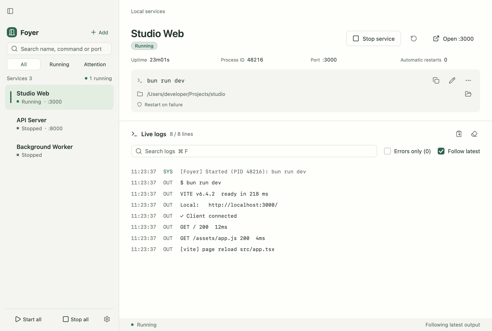

# Foyer

[简体中文](README.cn.md) · **English**

A home for your local services.

If starting your day means opening several terminal windows, finding project folders and typing the same commands again, Foyer can save those steps for you. Start a web project, chat tool or background task with a click, and keep its status and output in view.

**[Download the latest version](https://github.com/tanshiqi/foyer-releases/releases/latest)** · [Report an issue](https://github.com/tanshiqi/foyer-releases/issues)

## What you can do

- **Keep services together.** Save each project's folder and command, then start, stop or restart services individually or together.
- **See what's happening.** Check running status, uptime and logs, with clear messages when something goes wrong.
- **Recover from unexpected exits.** Turn on automatic restarts for services that need to keep running.
- **Use fewer windows.** Keep services running in the menu bar after closing the window, and hide the Dock icon if you prefer.
- **Keep a recovery copy.** Back up configurations before changes, or export a copy to restore later.

## Free edition and activation

Foyer free manages up to 3 services. A $6 one-time purchase unlocks unlimited services and service auto-start. Launching the app at login, logs, crash recovery and backups remain free.

Open Settings → License to purchase and enter the key from your email. A key supports up to 3 Macs; deactivate an old device before switching. Each successful validation allows 30 days offline. Services beyond the free limit are preserved when license status changes.

## Download and install

Foyer is available for macOS. Choose the DMG for your Mac:

- **Apple Silicon (M-series chips):** choose the file containing `arm64`.
- **Intel:** choose the file containing `amd64`.

Not sure which Mac you have? Open the Apple menu in the top-left corner and choose **About This Mac**.

Visit the [download page](https://github.com/tanshiqi/foyer-releases/releases/latest), open the appropriate DMG and drag **Foyer** into **Applications**. Open it from there.

The current release is not notarized by Apple. If macOS cannot verify the developer on first launch, first make sure the download came from this repository, then follow [Apple's instructions](https://support.apple.com/en-us/102445).

## Add your first service

1. Click the **+** button at the top of the sidebar.
2. Choose the folder containing your project.
3. Enter the command you normally use, such as `npm run dev` or `python app.py`. Give it a name, or leave the name blank to let Foyer name it.
4. Click **Save service**, then **Start service**.

Output appears in **Live logs**. If your service has a web address, use the open button in the top-right corner to open it in your browser.

You do not need Go or any build tools to install Foyer. Your project's own tools and dependencies, such as Python or Node.js, still need to be installed.

## Everyday use

Select a service in the sidebar to see its details and controls. Search by name or use the **Running** and **Attention** filters to find the service you need.

Search logs by keyword, or enable **Errors only**. Click a line to copy it. Turn off **Follow latest** to read earlier output at your own pace.

If a port is already in use, Foyer shows which process is using it. Only stop that process if you no longer need it.

## Make it yours

Open **Settings** using the gear at the bottom of the sidebar, the menu bar or with `⌘ ,`. You can:

- Switch the interface between **English** and **简体中文**. The choice is saved and takes effect immediately.
- Show or hide the Dock icon.
- Open Foyer at login, optionally in the background.
- Keep services running when you close the window, or quit and stop them.
- Show the running count in the menu bar and choose whether logs follow new output.
- Find or move your configuration, and manage backups.

Opening Foyer at login and starting a service automatically are separate choices. To start a particular service when Foyer opens, activate Foyer and enable that option in the service's advanced settings.

## Back up and restore

By default, Foyer saves a backup before changing an existing service configuration. In **Settings → Config & backups**, choose to keep the latest 5, 10 or 30 copies. You can also select **Back up now** or **Export backup…**.

Restoring first backs up your current configuration, then replaces the service list and stops current services. Imported services stay stopped until you start them.

Backups contain service settings, **not your project files**. Move those files separately when switching Macs. Backups also include environment variables you entered manually, so check for passwords or keys before sharing them.

## Common questions

### Do services keep running when I close the window?

Yes, by default. Reopen Foyer from the menu bar at the top of your screen, or change this behavior in Settings. Choosing **Quit Foyer** stops all services managed by the app.

### How do I reopen Foyer after hiding the Dock icon?

Click the Foyer icon in the menu bar. Its menu also has a Settings entry.

### What if a service will not start?

Check the error message and logs, then confirm the project folder, command and required tools are correct. If a port is occupied, close the program using it or configure your project to use a different port.

### Does deleting a service delete my project?

No. It removes the service from Foyer and stops it if it is running. Your project files stay in place.

### Where are my settings and logs?

Configurations and backups stay on your Mac, in `~/.config/foyer` by default. Open their folders from Settings. Logs are kept only while Foyer is running and cleared when it quits; copy any output you want to keep before exiting.

### How do I update?

Foyer checks for updates automatically and offers **Check for Updates…** in the app menu, menu bar and **Settings → About**. You can also download a new version from the [release page](https://github.com/tanshiqi/foyer-releases/releases/latest), quit Foyer and replace the older copy in Applications. Your service configuration is kept. You can export a backup first, too.

## Handy shortcuts

- `⌘ N`: Add service
- `⌘ K`: Search services
- `⌘ F`: Search logs
- `⌘ ,`: Open Settings

Have a question or an idea? Tell us in [GitHub Issues](https://github.com/tanshiqi/foyer-releases/issues). Include your macOS version, Mac chip type and any error messages. Remove private information before sharing logs.
